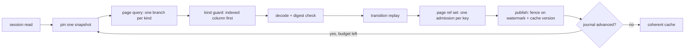

# Pasture performance

**Source of truth:** `pasture/docs/benchmarks/session-replay.md` (workload,
measured costs, invariants, how to measure). Read it first. This skill is the
procedure; the runbook is the record.

## Read before you measure

1. `pasture/docs/benchmarks/session-replay.md`
2. `pasture/docs/dbos-architecture.md` (durable runtime, queues, system DB)
3. `pasture/AGENTS.md` (dependency pins, timeout table, quality gates)

## Hot path



## Rules

1. **Measure first.** Restore a copy of the store and open it read-only. Never
   benchmark the live store while the daemon serves it.
2. **Count work, not only time.** Wall-clock is noisy on CI. Count queries,
   definition resolutions, rows scanned, or pages. The committed proof for the
   definition set is a count: two rows sharing a ref set must make four
   `LookupCommitted` calls, not eight.
3. **A speedup needs a call-site test.** The test must fail when the
   optimization is removed and when the boundary it guards is disabled. Helper
   unit tests alone do not pin the production path.
4. **Keep the invariants.** One pinned snapshot per scan; fence on publications
   (`completed_through_jid`, `cache_version`), never on ordinary writes; a
   publication clears `dirty`; a definition key is complete by construction and
   page-scoped.
5. **Measure the whole path.** A query fix can expose the next cost (definition
   resolution, per-row decode). Re-measure after each change.
6. **Run the gates.** `make test`; `make test-performance` for the write lane.
   Read-path changes get an independent A/B/C review wave.
7. **Prefer an exit-status command over a log grep.** `pasture rebuild session`
   rebuilds and exits; use its exit code.

## Commands

```sh
pasture rebuild session            # catch up, unbounded, exits when published
pasture rebuild session --full     # discard and replay the whole journal
pasture serve --backfill           # rebuild, then serve
make test-performance              # lane acceptance row + load harness
```

Query plan check: `EXPLAIN QUERY PLAN` for the page statement must show one
index seek per kind, no `MATERIALIZE` of `journal_attributed`, and no temp
B-tree over the remaining range.

## Anti-patterns

- A multi-kind `IN` with `ORDER BY journal_id`: it cannot stream, so it sorts the
  remaining range on every page.
- Joining `journal_attributed`: SQLite materializes the whole-journal view per
  page.
- A guard that leads with `journal_id` and filters `evidence_kind` after.
- Fencing a replay on `revision` or `dirty`: ordinary writes bump both.
- Resolving the same definition refs on every row.
- Grepping a server log for readiness instead of waiting on an exit status.
- Reporting a speedup from a deleted temporary harness. Commit the count-based
  test; keep the wall-clock numbers in the runbook.
